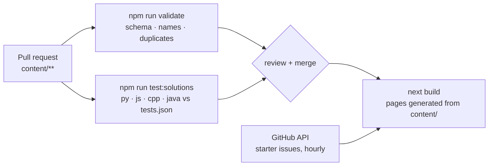

# CommitCamp

**A place to make your first open-source contribution, and then find your next one.**

CommitCamp has two halves:

- **Projects**: real repositories that welcome newcomers, each showing its open *good first issue* tickets pulled live from GitHub.
- **Challenges**: coding problems with tests. Read other people's solutions, or add your own in Python, JavaScript, C++ or Java, and CI checks it against the tests.

The site is itself the practice ground. Every challenge, solution and project listing arrives as a pull request, and every merged one shows up on the contributors page.

[](https://github.com/aaronanish-t/commitcamp/actions/workflows/ci.yml)

## Contribute in five minutes

1. Open a [challenge](content/challenges) that's missing a solution in a language you know.
2. Add `solutions/<your-github-username>.py` (or `.js`, `.cpp`, `.java`). It reads stdin and prints to stdout.
3. Open a pull request. CI runs your code against the tests and tells you exactly what differed if it fails.

No setup is needed: the **Add your solution** buttons on the site open GitHub's editor with the file already named. Full guide: [CONTRIBUTING.md](CONTRIBUTING.md).

## How it works



- **There's no database.** Content is files in `content/`, read at build time. The repo is the CMS and pull requests are the moderation queue.
- **One schema** (`lib/schema.ts`, zod) is enforced by the site, the validator and CI, so a malformed PR fails in CI rather than at deploy.
- **Credit is derived, not maintained.** The contributors page counts usernames from solution file names and `author` / `added_by` fields, so there's no list to forget to update.
- **Raw HTML in Markdown is escaped.** Content comes from strangers, so a missed `<script>` in review can't ship.
- **The projects page degrades gracefully.** It revalidates hourly, and if GitHub is unreachable or rate-limited each card falls back to a link to the filtered issue list.

## Running locally

```sh
npm install
npm run dev               # http://localhost:3000
npm test                  # unit tests (vitest)
npm run validate          # check all content
npm run test:solutions    # run every solution against its tests
npm run new:challenge -- <slug> <github-username>
```

Optional: `GITHUB_TOKEN` in `.env.local` (a token with no scopes is enough) raises the GitHub API limit from 60 to 5,000 requests an hour.

## Licence

Code (the site, scripts and solutions) is under [MIT](LICENSE). Written content (challenge statements and project descriptions) is under [CC BY 4.0](https://creativecommons.org/licenses/by/4.0/).
